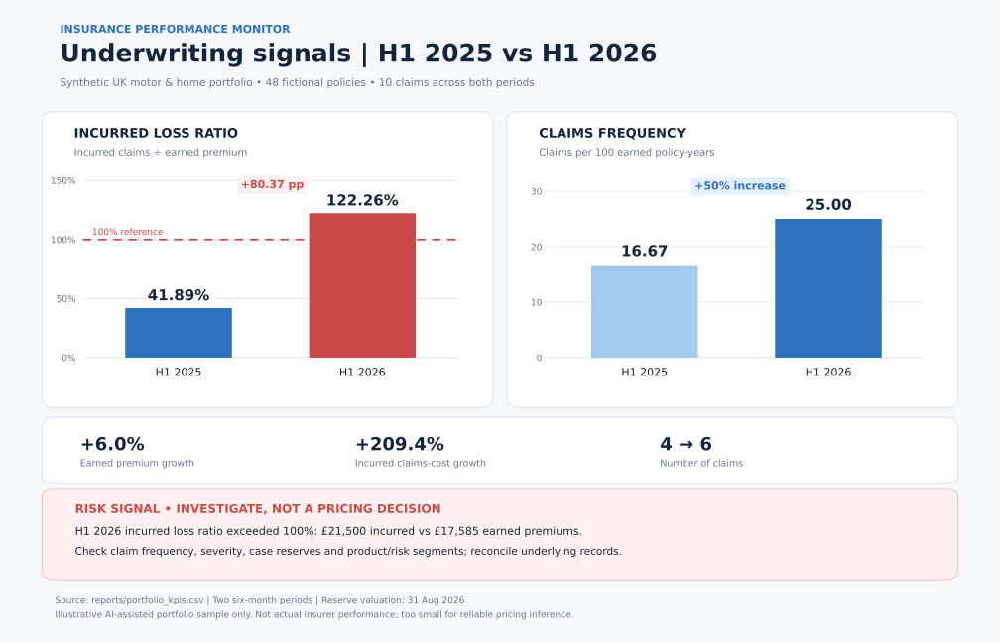

# Insurance Claims & Underwriting Performance | SQL Portfolio

**Independent, AI-assisted SQL portfolio case study** examining synthetic UK motor and home insurance policies. Built to demonstrate the database modelling, financial reconciliation and data-quality judgement required in insurance pricing and underwriting monitoring.

> **Portfolio project, not professional insurer experience.** All policyholder, premium, claim and payment data are invented. This is a new insurance-domain SQL demonstration, not a university assignment or a project completed for an insurer.

## The business question

**Are premiums keeping pace with claims costs, and which segments require closer investigation?**

The project implements a **five-table relational MySQL database** that separates policy exposure and earned premium from claim events and payments. It uses aggregate SQL reports and explicit consistency checks to explore underwriting performance without double-counting claims or premiums.

## Key findings from the fictional demonstration data

| H1 reporting period | Earned premium | Claims | Frequency / 100 policy-years | Incurred claims | Incurred loss ratio |
|---|---:|---:|---:|---:|---:|
| 2025 | £16,590.00 | 4 | 16.67 | £6,950.00 | 41.89% |
| 2026 | £17,585.40 | 6 | 25.00 | £21,500.00 | 122.26% |

**Synthetic-sample observation:** Reported claim frequency rose from **16.67 to 25.00 claims per 100 earned policy-years**; incurred loss ratio rose from **41.89% to 122.26%**. The analysis reconciles **10 claims**, including claims with more than one payment transaction.


## Underwriting performance dashboard



**Risk identified:** H1 2026 incurred loss ratio was **122.26%**, exceeding the 100% claims-to-premium benchmark by 22.26 percentage points (and up 80.37 points year on year), while claims frequency rose from **16.67 to 25.00 per 100 earned policy-years**. Earned premiums rose approximately 6%, but incurred claims rose approximately 209%. These are **investigation signals, not proof of a market trend or sufficient evidence for a pricing change**, given just 48 synthetic policies and 10 claims.

The dashboard is built from [period-level SQL KPI output](reports/portfolio_kpis.csv). Review the [Matplotlib source](scripts/plot_underwriting_dashboard.py) to see the source-data reconciliation checks and how the chart is generated. To reproduce the **PNG and SVG** locally, install Matplotlib and run:

```bash
python3 -m pip install matplotlib
python3 scripts/plot_underwriting_dashboard.py
```

The source records are fabricated and all charts must be labelled as illustrative. The [original single-metric loss ratio chart](assets/loss_ratio_by_period.svg) is retained for comparison.

The sample shows a deterioration in incurred loss ratio despite premium growth. This is a signal to **investigate**, not a reliable pricing recommendation, because the sample includes only 48 policies and case reserves are illustrative.

## Technical capabilities demonstrated

- **Relational modelling:** implemented five connected tables, primary/foreign keys, unique exposure periods, nonnegative financial constraints and date validation.
- **Insurance KPIs:** calculated annualised **claim frequency per 100 earned policy-years**, average incurred claim severity and **incurred loss ratio** (paid + reserve / earned premium).
- **SQL analysis:** used aggregate views, joins, left joins, GROUP BY, conditional aggregation, NULLIF and reporting by product, risk band and distribution channel.
- **Reconciliation:** aggregated multiple payment rows per claim **before** joining claims to policy exposure, avoiding the common error of duplicated claim counts or premium totals.
- **Quality assurance:** wrote 11 SQL validation checks plus seven automated regression tests in Python's standard-library `unittest` framework.
- **Visualisation and risk reporting:** added a two-panel underwriting dashboard with a 100% loss-ratio benchmark, frequency comparison and explicit risk interpretation. Matplotlib script independently reconciles CSV totals before drawing charts.

## How to run

Requires **MySQL 8.0+**. From the repository root, run:

```bash
mysql -u root -p < sql/01_schema.sql
mysql -u root -p insurance_portfolio_demo < sql/02_seed_data.sql
mysql -u root -p insurance_portfolio_demo < sql/03_metric_views.sql
mysql -u root -p insurance_portfolio_demo < sql/04_business_questions.sql
mysql -u root -p insurance_portfolio_demo < sql/05_quality_checks.sql
```

**Caution:** `01_schema.sql` drops and recreates the demo database. Never run it against a real database.

To execute the **SQLite-compatible automated regression tests**, no external Python package is needed:

```bash
python3 -m unittest discover -s tests -v
```

The test harness adapts limited MySQL-specific setup syntax to SQLite. Passing those tests is **not** proof that the scripts were executed on a MySQL server; MySQL 8.0 end-to-end verification remains a separate step.

## Repository guide

| Path | Contents |
|---|---|
| `sql/01_schema.sql` | Five-table relational schema |
| `sql/02_seed_data.sql` | Reproducible fictional records (48 policies, 2 periods) |
| `sql/03_metric_views.sql` | Claim-cost consolidation and KPI views |
| `sql/04_business_questions.sql` | Five underwriting and claims questions |
| `sql/05_quality_checks.sql` | Data-quality and reconciliation checks |
| `tests/test_metrics.py` | Regression tests for logic and constraints |
| `reports/portfolio_kpis.csv` | Reproducible period-level KPI output |
| `assets/underwriting_performance_dashboard.svg` | Visual portfolio risk dashboard |
| `scripts/plot_underwriting_dashboard.py` | Reproducible Matplotlib PNG/SVG chart source |
| `docs/data_dictionary.md` | Data definitions, formulas and limitations |
| `docs/architecture.md` | ER diagram and modelling decisions |

## Interpretation and safeguards

All figures are illustrative: 48 fictional policies over two half-year periods and only 10 fictional claims. Reserve amounts are simplified; no IBNR, inflation or claim development is modelled. These results must **not** be used for insurance pricing or decisions on actual customers. See [metric definitions](docs/data_dictionary.md).

**Project provenance:** This is a newly created, AI-assisted portfolio demonstration using synthetic insurance records. It was not developed for an insurer or submitted as academic coursework. Review and validate the code before presenting particular implementation choices as personal experience.
