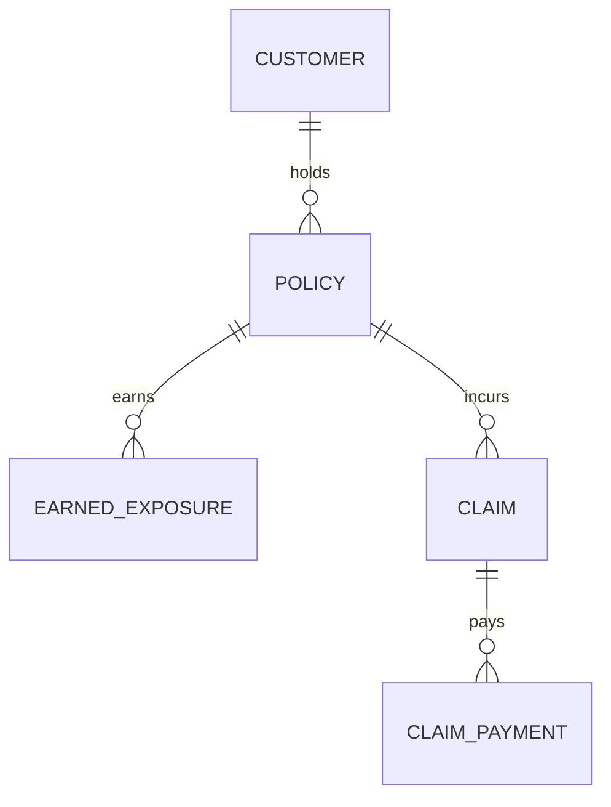

# Relational database architecture

## Design choices

1. Separate **earnings/exposure** records from **claim transactions** so a claims join cannot duplicate premium or policy-year exposure.
2. Track **claim payments separately** to support multiple transactions, an important reporting pitfall in insurance datasets.
3. Enforce **referential integrity** via primary and foreign keys. Use `RESTRICT` on parent records to avoid accidental deletion of insurance history.
4. Add uniqueness of `(policy_id, period_start)` and nonnegative money constraints to prevent common data-quality problems.
5. Record **outstanding case reserve at a common valuation date** rather than labelling payments as total claim cost.

## Project scope and provenance

The insurance schema, synthetic policy/claims/payment data, loss-ratio and exposure-based frequency formulas, business questions and tests form a separate, AI-assisted portfolio case study. It is not insurance work performed for a company and has not been submitted as a university assignment.
